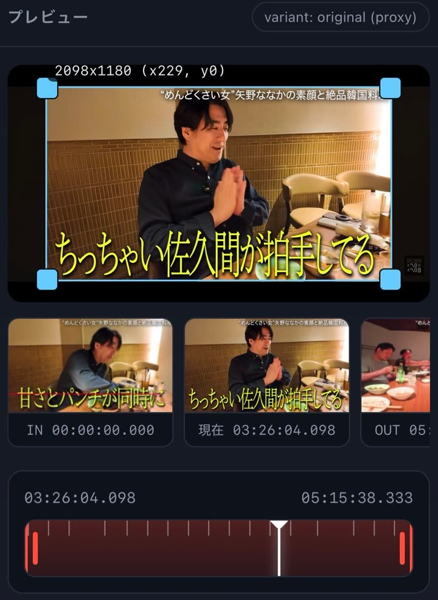
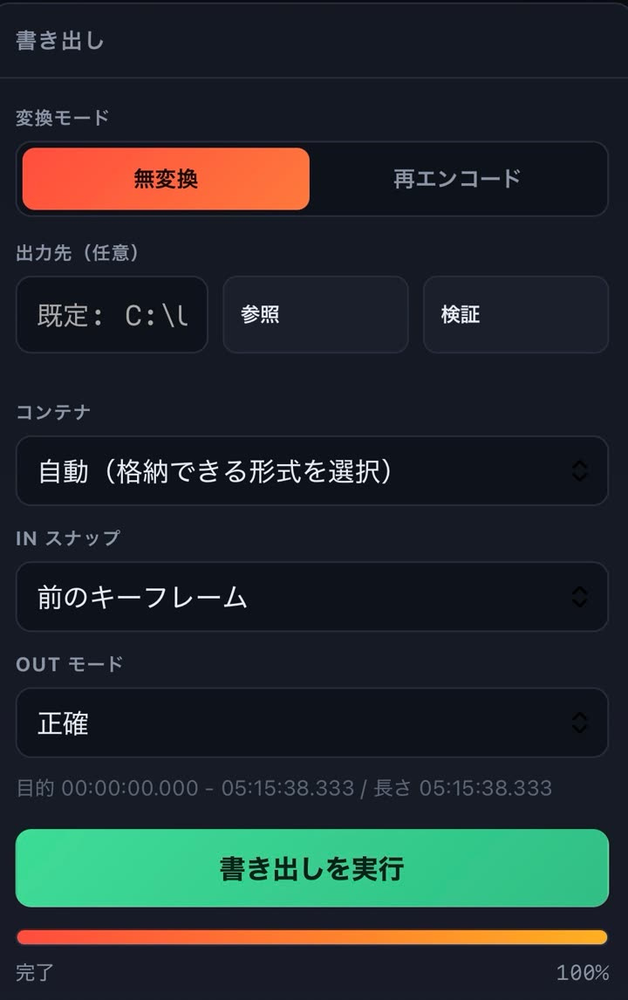

[日本語](README.md) | **English**

# TrimStudio — lossless video & audio trimming for Windows

A **lossless (no re-encoding) trimming tool** you can drive from your phone's browser.
Cut video without losing quality.
It runs on your Windows PC.
You operate it from a phone on the same Wi-Fi.

## Features

1. **Runs on your Windows PC**
   It works with the video and audio files already on your PC (no upload needed), and writes the trimmed file straight back to a folder on that PC.

2. **You can operate it from your phone**
   The PC only has to be running. Open the URL in your phone's browser to pick a file, play it, set the cut points and export. A mouse on the PC works the same way.

3. **Trimming is lossless**
   Video and audio are `copied as-is`, without re-encoding. Because nothing is re-encoded, picture and sound quality stay exactly as they were (a lossless, no-conversion cut).

---

## Screenshots

The screen while operating from a phone.

| Preview | Export settings |
|---|---|
|  |  |

- **Preview**: the **crop box** (the area to keep; its size and position are shown at the top left, e.g. 2098x1180 (x229, y0)) sits over the video. Below it are **IN / now / OUT** thumbnails, and the timeline is at the bottom. The **yellow ticks** on the timeline are **keyframes** (the reference frames of the video). The red band shows the range that will be cut out.
- **Export settings**: choose **Lossless / Re-encode**, the **output folder** (browse and check), the container (the file format that wraps the video, such as MP4), IN snap, OUT mode and the range to export. The green button at the bottom is **Export**.

> Note: the video area in the screenshots is blurred so the content cannot be identified.
> Note: the screenshots show an older version. The timeline is now split into two rows: the top row is IN/OUT and the bottom row is the playback position.

---

## Requirements

- Windows 10 / 11
- Python 3.11 or newer (tested on 3.13)
- ffmpeg (the program that processes video) is installed automatically. On first start it downloads the pinned version 9.0.2 from gyan.dev and verifies it with SHA-256.
  - Source: https://www.gyan.dev/ffmpeg/builds/ (essentials build, GPL)

## Setup (for first-timers — 4 easy steps)

### Step 1: download this tool

1. Press the green `Code` button at the top right of this page.
2. Press `Download ZIP` at the bottom of the menu.
3. **Right-click the downloaded `TrimStudio-master.zip` and choose "Extract All"**.
4. **Move the resulting folder (`TrimStudio-master`) somewhere easy to find.** This avoids trouble later.
   - Recommended: a **short path with only ASCII letters and digits**, such as `C:\TrimStudio`.
   - Avoid: paths with Japanese characters or many spaces, and anything inside OneDrive (these cause errors).

> If you are comfortable with `git`, `git clone https://github.com/brad-55/TrimStudio.git` works too. That is for advanced users.

### Step 2: install Python

1. Open https://www.python.org/downloads/windows/.
2. Download **Windows installer (64-bit)** from the latest Python 3 release and run it.
3. **Be sure to tick `Add python.exe to PATH` at the bottom of the first screen.** Confirm the tick, then press "Install Now" to start the installation.
   - If you forget the tick you will see "Python was not found". Re-run the installer to add it.
4. Press the `Windows` key, type `cmd` and press Enter.
5. In the black window, check the installation:

```
python --version
```

If it prints something like `Python 3.13.x`, you are good.

### Step 3: start it

1. Open the folder you extracted in step 1.
2. Double-click **`start.cmd`**.
3. The first run takes a few minutes. It prepares everything by itself:
   - installing the required packages;
   - downloading ffmpeg (the video processing engine).
4. When it is ready, the black window shows the URL to open from your phone:

```
  From a phone or another PC:  http://192.168.1.23:8003/
```

- **Do not close this black window.** Closing it stops the tool. You can close it when you are done.
- If Windows shows "Windows protected your PC", press `More info` then `Run` (this appears because the tool is not signed).

### Step 4: open it from your phone

1. Connect your phone to the **same Wi-Fi as the PC**.
2. In your phone's browser (Safari / Chrome), open the URL from step 3.
3. If Windows Firewall asks for permission the first time, press **Allow access**.

> If the phone cannot open it, see "Troubleshooting" below.

### Troubleshooting (common questions)

- **The phone cannot open it**
  - Check that the phone and PC are on the same Wi-Fi. A phone on mobile data (4G/5G) cannot reach it; turn mobile data off and join Wi-Fi.
  - Allow it through the firewall. Open a black window as administrator and run:

```
netsh advfirewall firewall add rule name="Trim 8003" dir=in action=allow protocol=TCP localport=8003 profile=private
```

- **"Port 8003 is already in use"**: the port (the numbered door for communication) is taken. Change `port` in `config.json` to something like `8010` and run `start.cmd` again.
- **"Python was not found"**: you missed the PATH tick in step 2. Run the Python installer again.
- **The black window disappears instantly**: check that the folder path has no Japanese characters or spaces (use something like `C:\TrimStudio`).
- **Export says "cannot write"**: the destination folder has no write permission. Choose a writable place such as the Desktop or under `C:\TrimStudio`.
- **A loaded file will not play**: see "Opening H.265 / 10-bit files" below and generate a proxy.

## Using it away from home (Tailscale / tailnet)

To use it outside your home Wi-Fi (over mobile data), use **Tailscale** (a free VPN).
Only devices that joined the same tailnet can connect.

1. **Install Tailscale on both the PC and the phone and sign in with the same account.**
2. Find the PC's tailnet address.
   - Hover the Tailscale icon in the task tray to see your PC name and IP.
   - From a black window: `tailscale ip -4` (for example 100.70.95.77).
3. Open one of these in the phone's browser:
   - `http://<PC tailnet address>:8003/` (for example http://100.70.95.77:8003/)
   - With MagicDNS enabled, `http://<PC name>:8003/` (for example http://desktop-515r9ue:8003/)
4. Allow it through Windows Firewall the first time (same as step 4 above).

- Tailscale addresses (100.64.0.0/10) and `*.ts.net` names are **allowed automatically**. Set `allowTailnet` to `false` to disable tailnet access.
- When using it away from home, setting `strongMode` to `true` in `config.json` is recommended (you must enter the token shown at startup before you can do anything).
- Devices on your tailnet are **trusted by definition**. Do not invite people you do not know.
- 100.64.0.0/10 is a shared range that some ISPs also use internally. It is fine on ordinary home connections, but in the unusual case where your LAN uses 100.64.0.0/10, devices on that LAN are also treated as allowed sources (set `allowTailnet` to false if that worries you).
- It works the same way from home Wi-Fi and from the tailnet address.

## How to use

1. Open the URL on your phone.
2. Use **PC videos** to browse to a file, or **Upload** to send a video or audio file. The file is loaded for editing.
3. If the video will not play, press **Generate proxy**. A proxy (a light preview copy) is created and playback starts working. Exporting still uses the original quality.
4. Set IN (start) and OUT (end) with the timeline, by typing times, or with the frame steps (±1 frame / ±1 second / ±keyframe). This fixes the range to cut. The yellow ticks on the timeline are keyframes (reference frames).
5. Open the export settings if you need them: lossless / re-encode, output folder, and container (MP4 and other wrappers).
6. Press **Export**. Progress appears, and the output path is shown when it finishes.

### While an export is running

- **Load another video**: you can open and edit another video during an export. The running export keeps going.
- **Queue the next export**: you can line up several exports in a queue. They appear in the job list as waiting or running.
- **Close the browser**: closing the phone browser does not stop the work on the PC. You can check the result later in the job list.
- **Stop an export**: press "Stop export" next to the progress display to cancel it.

### Remembered settings and start folders

- The mode, container, output folder, encoder, bitrate, LUT, stabilizer, audio re-encode, IN/OUT settings, **display zoom** (top right of the header) and crop values are **remembered by the browser** and restored the next time you open it. A remembered crop is restored only for the same video (adjusted to its size); it is not carried over to another video.
- **Audio timing (mode, shift, extra track, extra-track re-encode) is per video**: opening another video resets it to "original only, 0 ms, no extra track, re-encode off", so a correction meant for one clip is never applied to another (it is not part of the remembered settings).
- **Choose from PC** opens **your Windows Videos folder**.
- **Browse** next to the output folder opens the **folder you used last time**.

### Output folder (defaults and verification)

- The defaults when the output folder is left empty: files from your PC are written **next to the source video**; uploaded files go to **your Windows Videos folder**.
- The **Check** button resolves the real destination even when the field is empty (the default), and shows whether it is writable and how much space is free.

### Where to keep LUTs (colour conversion files)

Choosing **Re-encode** shows a LUT (colour look-up table) field. You can put LUT files there in any of these ways:

- **Put them on the PC**: press **Open on PC** to open the LUT folder in Explorer (by default the tool's `luts` folder). Drop `.cube` / `.3dl` / `.dat` files in and press **Reload**.
- **Send from the phone**: press **Add LUT** and pick a file; it is copied into the LUT folder.
- **Change the folder**: press **Choose folder** to point the LUT folder anywhere on the PC (the setting is kept for next time).

### Save the current frame as an image

- You can save the single frame at the playback position as a JPEG at the source video's width.
- **iPhone**: press **Save current frame**, then **Save to Photos / Share**. Choose **Save Image** in the share sheet to put it in your photo library. If that fails, **press and hold** the image and choose **Add to Photos**.
- **Android / PC**: press **Download**, or use the share sheet to save to a photo app or files.

### Seek bar and IN/OUT (trim) controls

You drive it with three **handles (◆)**. Their **vertical positions differ**, so you cannot grab the wrong one.

- **Playback position (white line)**: its ◆ sits in the **upper part of the bar**. Grab near the ◆ (about 40 px either side) and drag left or right to move the playback position.
- **IN / OUT (red lines)**: their ◆ sit in the **lower part of the bar**. The IN ◆ moves IN and the OUT ◆ moves OUT.
- **Touching anywhere away from a ◆ does nothing** (tapping the bar does not seek by itself). This is what prevents mis-operation.
- Once grabbed, the cursor **follows the movement of your finger** (it does not jump to the finger).
- Movements under 3 px do not change any value.
- IN and OUT never cross each other (they stop at one another).
- Other ways to set the points: type a time, use ±1F / ±1s / ±keyframe (moves the playback position), or press "Set to current position" (sets IN or OUT to the playback position).

### Crop

- Choosing **Re-encode** shows a **blue box** over the preview.
  - Drag inside the box to move it. Drag the corners or edges to resize it (values snap to even numbers).
- **Full / 16:9 / 9:16 / 1:1 / 4:3** set it quickly. **With "Full" the Full button is highlighted.**
- Typing numbers updates the box as well. A box that still covers everything is treated as "no crop".
- Cropping is recorded in the exported file name, e.g. `切抜320x180`.
- Videos with **rotation metadata** (for example a phone held upright) are cropped correctly in the orientation you actually see.

### Reading exported file names

An exported file is named `<original name>_切出<start>-<end>_<mode and options>.<ext>`.

- Example 1 (lossless): `IMG_1234_切出0s-2s_無変換.mp4`
- Example 2 (re-encode): `IMG_1234_切出1m30s-1m35s_再エンコード_H265_1500kbps_音声再圧縮_LUT_手ブレ補正_切抜320x180.mp4`
- Example 3 (audio only): `song_切出0s-30s_音声再エンコード_音声192kbps.mp3`

Times are written in readable form, e.g. `0s` / `1m30s` / `1h02m03s`.

(These Japanese words mean: `切出` = cut, `無変換` = no re-encoding (the cut is lossless), `再エンコード` = re-encode, `音声再圧縮` = audio re-encode, `手ブレ補正` = stabilizer, `切抜` = crop, `音声` = audio.)

### Downloading the exported file

- The result panel after an export has **Save file** (on iPhone, choose **Save to Files** in the share sheet).
- Finished jobs in the job list also have **Save file**.
- Every file row in File Explorer has a **Download** button too.

### Copy and move in File Explorer

- The **Copy** and **Move** buttons on each file row let you choose a destination and run the operation (whole folders work too).
- They run in the background, so progress appears in the job list and you can stop them. If a file with the same name exists, a number (-1, -2, …) is added automatically so nothing is overwritten.

### When the app does not respond

- The spinner appears only when a request takes longer than 0.2 seconds.
- If there is no response for **25 seconds**, a "No response — resume" button appears. Press it to get straight back to work.
- API calls have time limits (60 seconds normally, 30 minutes for uploads). On failure a Japanese error message is shown and the screen always becomes usable again.

### Opening H.265 / 10-bit files

- Common browsers **cannot play H.265 (HEVC) or 10-bit video directly**. Opening such a file shows "this format cannot be played directly in the browser". Press **Generate proxy**: it creates a light H.264 preview file (proxy) that plays. The proxy is for viewing only; **exporting stays lossless at the original quality**.
- When re-encoding with H.265 (NVENC), an 8-bit source stays 8-bit (only 10-bit or HDR sources are written as 10-bit).

## Other features

- Lossless cut: video and audio packets are copied as they are, so there is no quality loss.
- Audio files (mp3 / m4a / aac / wav / flac / ogg / oga / opus / wma / aif / aiff) can be trimmed in the same screen.
- Camera-specific extensions are supported: Insta360 and GoPro **.lrv**, Insta360 **.insv / .insp**, GoPro 360 **.360**, professional **.mxf**, DV **.dv**, DVD **.vob**, RealMedia **.rm / .rmvb** and more.
  - Files that contain MP4 data (such as .lrv) are exported as MP4. For formats (codecs) that cannot be played, generate a proxy to inspect them.
  - .insp is an Insta360 still image; it is treated as a one-frame video.
- If a file with the same name exists, a number (`-1`, `-2` …) is added automatically so nothing is overwritten (upload names behave the same way).
- If the output folder is not writable, a clear error explains why. Change the destination folder and try again.
- Metadata display: resolution, fps, duration, size, container, bitrate, profile, colour information and audio channels. **Detailed metadata** shows every stream and tag.
- Re-encoding accepts video and audio bitrates in kbps (leave them empty to use CRF for video and to follow the source audio settings).
- Optional features (not lossless; quality loss is minimised): LUT, stabilizer, and crop.
- The listening port is 8003 and only private IP addresses (safe home or office networks) are allowed.
- The current UI is **TrimStudio** (`/`). The older UI is still available at `/web/`.

## How lossless cutting works and its limits

- A lossless cut copies video and audio packets without re-compressing them, so the start point snaps to the preceding keyframe (reference frame).
- By default the IN point is aligned to the preceding keyframe and the OUT point is cut at the requested time. For the OUT point you can also choose "previous keyframe" or "next keyframe".
- The difference between the requested time and the position actually cut is shown on screen. On videos with long keyframe intervals the IN point can be off by up to one GOP (the span between reference frames).
- The output container is chosen automatically to fit the data by default. You can also pick MP4, MOV, MKV, WebM and others by hand. If the chosen combination cannot hold the streams, an error explains why; pick another format.
- Audio has no keyframe constraint: it is cut exactly at the requested time (only FLAC performs a lossless reversible re-encode to fix the playback information).
- Incomplete temporary files left in the output folder (`*.part.*`) are deleted automatically on the next export if they are more than an hour old.
- Output is always a new file. The source file is never modified.

## Optional features (not lossless)

- **LUT**: `.cube` / `.3dl` / `.dat` (the folder can be chosen in the UI)
- **Stabilizer**: ffmpeg's vidstab (a two-pass analysis) reduces camera shake
- **Crop**: cut by width, height, x and y (works with rotation metadata too)
- Enabling these re-encodes the video, so the quality is not bit-for-bit identical to the source. Quality-focused settings are used by default.

## Security

- Connections are allowed only from private source IP addresses (RFC1918, ULA, link-local, loopback) and, when `allowTailnet` is true, from the Tailscale tailnet range (100.64.0.0/10).
- The Host header is validated to block unauthorised access.
- APIs that change settings require a CSRF token (X-Trim-Token).
- File browsing and downloads are limited to **video and audio extensions** under the allowed folders, verified with realpath so files cannot be pulled from elsewhere.
- ffmpeg is launched with an argument array (no shell) for safety.
- For stricter operation, set `strongMode` to `true` in `config.json`: nothing can be done until the token shown at startup is entered.
- In normal mode, `GET /api/token` returns the token (LAN-only access is assumed. The token works together with CSRF, same-origin and Host checks).

## Settings (config.json)

To change settings, copy `config.example.json` to `config.json` and edit it. Main keys:

- `allowedRoots`: folders that may be browsed (default: all fixed drives)
- `denyRoots`: folders that are explicitly denied
- `port`: listening port (default 8003)
- `lutsDir`: folder that holds LUTs (also changeable from the UI)
- `workCacheBytes`: work-cache limit (oldest entries are deleted first)
- `maxUploadBytes`: upload limit
- `previewMode`: preview mode (auto / original / proxy)
- `strongMode`: protection mode that requires the token
- `allowTailnet`: allow access over Tailscale (tailnet), default true; `false` disables it

## Tests

```
.venv\Scripts\python.exe tests\test_unit.py
.venv\Scripts\python.exe tests\e2e_api.py        (run while the server is up)
.venv\Scripts\python.exe tests\e2e_lossless.py   (lossless offsets, boundary match, A/V sync, duration)
.venv\Scripts\python.exe tests\e2e_edge.py       (boundaries such as IN=0, security, Range)
.venv\Scripts\python.exe tests\e2e_features.py   (variant / frames / sprite / upload / delete)
.venv\Scripts\python.exe tests\e2e_metadata.py   (metadata, bitrates, folder creation)
.venv\Scripts\python.exe tests\e2e_download.py   (download paths)
.venv\Scripts\python.exe tests\e2e_fsops.py      (copy and move)
.venv\Scripts\python.exe tests\check_ui_static.py (static UI guards)
```

`e2e_lossless.py` and `e2e_edge.py` verify that lossless cutting is correct. See `docs/API.md` for the API.
### Audio timing (shift / extra track)

You can shift the audio later or earlier to fix lip-sync drift while keeping the cut **lossless** (packet copy).

- Use the **audio timing** panel to set the original audio shift, the extra track and the mode.
- **Original audio shift**: type a value in ms (no upper limit) or use the **relative slider whose centre is the current value**. Positive delays, negative advances.
- **Extra audio track**: add the audio of another file, with its own start position (ms) and shift.
- **Auto sync**: analyses the two tracks and proposes an offset (several windows of a few seconds each).
- **Modes**: original only / extra only / both tracks (two lossless tracks) / mix (audio is re-encoded) / mute.
- **Applying a preview**: the timing is baked into a **preview-only file (proxy)** that plays as ONE video. After changing a setting, press **Apply to preview** (the button is disabled while it is being generated). Until you do, the original audio plays, so the shift is not audible yet. **Revert** goes back to the original playback.
- **Opening another video resets the timing**: it is a per-video value, so a new video starts again at original only / 0 ms (it is not part of the remembered settings).
- The exported audio packets stay bit-identical to the source when shifting; only the mix mode re-encodes audio.


## Directory layout

```
app/      backend
web/      old UI
web-qwen/ UI (the TrimStudio app)
luts/     default LUT folder
data/     database, work area, logs
docs/     plans and review records
tests/    tests
```

---

[](https://github.com/deepseek-ai/deepseek-harness)
