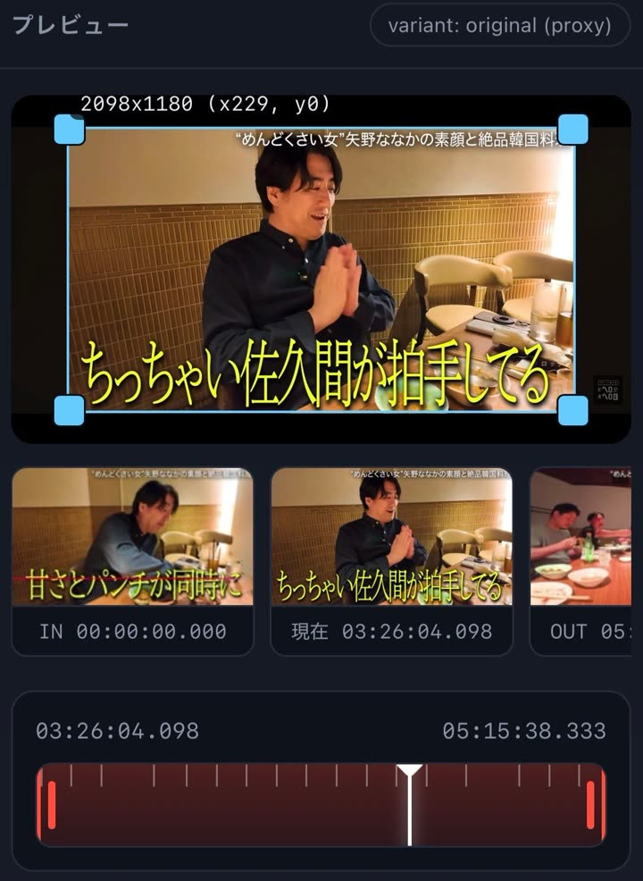
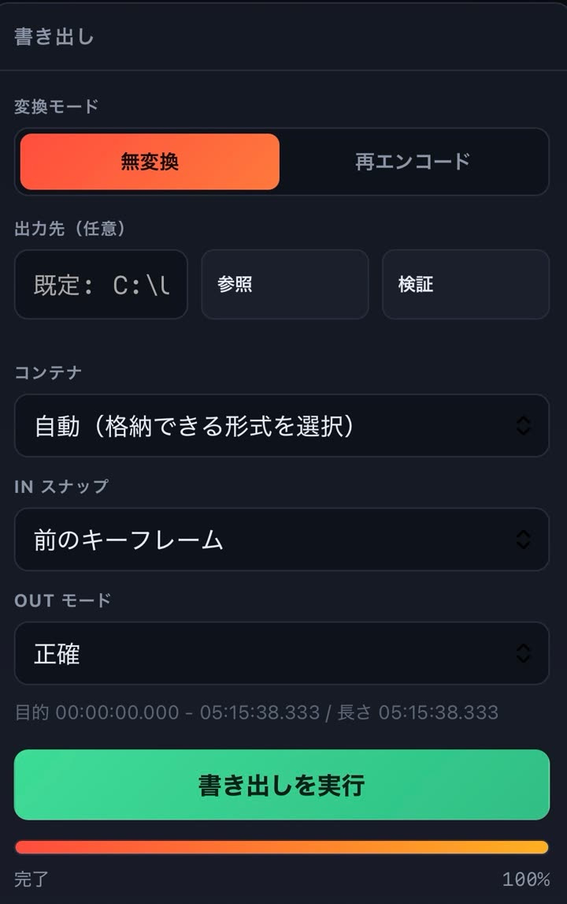

**日本語** | [English](README.en.md)

# TrimStudio — 無劣化で動画・音声を切り出す Windows 用ツール

スマホのブラウザから操作できる、**無劣化（無変換）トリミング**ツールです。
画質を落とさずに切り出せます。
Windows の PC で動かします。
同じ Wi-Fi につないだスマホから操作します。

## 特徴

1. **Windows PC 上で動きます**
   PC 内の動画や音声をそのまま扱えます（アップロードの必要はありません）。切り出したファイルも PC のフォルダに直接保存します。

2. **操作はスマホからもできます**
   PC 側は起動しておくだけで構いません。スマホのブラウザで URL を開けば、動画の選択、再生、切り出す位置の指定、書き出しまで行えます。PC のマウスでも同じように操作できます。

3. **無劣化でトリミングできます**
   映像と音声を `再エンコードせずそのままコピー` して切り出します。再エンコード（画質を変える再変換）を行わないため、画質や音質は元のまま保たれます（無変換カット）。

---

## 画面イメージ

スマホで操作しているときの画面です。

| プレビュー画面 | 書き出し設定 |
|---|---|
|  |  |

- **プレビュー画面**: 映像の上に**クロップ枠**（切り抜く範囲の枠。左上にサイズと位置を表示、例 2098x1180 (x229, y0)）があります。下に **IN / 現在 / OUT** のサムネイルがあり、一番下にシークバーがあります。シークバーの**黄色い目盛りがキーフレーム**（動画の基準となるコマ）です。赤い部分が切り出す範囲を示します。
- **書き出し設定**: 「**無変換 / 再エンコード**」の切り替え、**出力先**（参照・検証）、コンテナ（MP4 など動画の箱となるファイル形式）、IN スナップ、OUT モード、書き出す範囲を設定します。いちばん下の緑のボタンが「**書き出しを実行**」です。

> ※ スクリーンショットの映像部分は、内容が分からないようにぼかし加工しています。
> ※ スクリーンショットは旧バージョンの画面です。現在のシークバーは「上段＝IN/OUT、下段＝再生位置」の2段になっています。

---

## 動作環境

- Windows 10 / 11
- Python 3.11 以上（3.13 で動作確認）
- ffmpeg（動画を処理するプログラム）は自動で入ります。初回起動時に固定バージョン 9.0.2 を gyan.dev からダウンロードし、改ざんがないか SHA-256 で検証します。
  - 入手元: https://www.gyan.dev/ffmpeg/builds/ （essentials ビルド / GPL 版）

## セットアップ（はじめての人向け・かんたん4ステップ）

### ステップ1: このツールをダウンロードする

1. このページの右上にある緑色の `Code` ボタンを押します。
2. メニューの一番下にある `Download ZIP` を押します。
3. ダウンロードした `TrimStudio-master.zip` を**右クリック → 「すべて展開」**します。
4. できたフォルダ（`TrimStudio-master`）を、**分かりやすい場所に移動**します。トラブルを防ぐためです。
   - おすすめ: `C:\TrimStudio` のように、**英数字だけの短いパス**（保存場所の文字列）です。
   - 避けたい場所: 日本語やスペースが多い場所、OneDrive の中です（エラーの原因になります）。

> `git` コマンドを使える人は `git clone https://github.com/brad-55/TrimStudio.git` でもかまいません。上級者向けです。

### ステップ2: Python をインストールする

1. https://www.python.org/downloads/windows/ を開きます。
2. 「Latest Python 3 Release」の **Windows installer (64-bit)** をダウンロードして実行します。
3. 最初の画面の下にある **`Add python.exe to PATH` のチェックを必ず入れます**。チェックを確認してから「Install Now」を押すと、インストールが始まります。
   - チェックを忘れると「Python が見つかりません」と出ます。忘れた場合は Python を再インストールしてください。
4. キーボードの `Windows` キーを押して `cmd` と入力し、Enter キーを押します。
5. 黒い画面で次を入力して、正しく入ったか確認します:

```
python --version
```

`Python 3.13.x` のように表示されれば成功です。

### ステップ3: 起動する

1. ステップ1で展開したフォルダを開きます。
2. 中にある **`start.cmd`** をダブルクリックします。
3. 初回はそのまま数分待ちます。自動で準備が進みます:
   - 必要な部品をインストールします。
   - ffmpeg（動画処理エンジン）をダウンロードします。
4. 準備が終わると、黒い画面に URL（スマホから開く住所）が表示されます:

```
  スマホや他のPCから:  http://192.168.1.23:8003/
```

- この黒い画面は**閉じないでください**。閉じるとツールが停止します。使わないときは閉じて構いません。
- 「Windows によって PC が保護されました」と出た場合は、`詳細情報` → `実行` を押すと起動できます（自作ツールのために表示されます）。

### ステップ4: スマホから開く

1. スマホを **PC と同じ Wi-Fi** につなぎます。
2. スマホのブラウザ（Safari / Chrome）で、ステップ3で出た URL を開きます。
3. 初回に Windows のファイアウォール（通信を守る機能）の確認が出たら、**「アクセスを許可する」** を押します。

> スマホから開けないときは「うまくいかないとき」の節を見てください。

### うまくいかないとき（よくある質問）

- **スマホから開けない**
  - スマホと PC が同じ Wi-Fi か確認してください。スマホがモバイル通信（4G/5G）だと開けません。モバイル通信をオフにして Wi-Fi につないでください。
  - ファイアウォール（通信を遮断する機能）で許可してください。管理者として黒い画面を開き、次を実行します:

```
netsh advfirewall firewall add rule name="Trim 8003" dir=in action=allow protocol=TCP localport=8003 profile=private
```

- **「ポート 8003 は使用中」と出る**: ポート（通信の出入口番号）が使われています。`config.json` の `port` を `8010` などに変えて、もう一度 `start.cmd` を実行してください。
- **「Python が見つかりません」と出る**: ステップ2の PATH のチェックを忘れています。Python のインストーラーをもう一度起動して入れ直してください。
- **黒い画面が一瞬で消える**: フォルダのパス（保存場所）に日本語やスペースが入っていないか確認してください（`C:\TrimStudio` などの英数字の場所を推奨します）。
- **書き出しで「書き込めません」と出る**: 保存先のフォルダに書き込み権限がありません。デスクトップや `C:\TrimStudio` の下など、書き込める場所に変更してください。
- **読み込んだファイルが再生できない**: 下の「H.265 / 10bit のファイルを読み込んだとき」を見て、プロキシを生成してください。

## 外出先から使う（Tailscale / tailnet）

自宅の Wi-Fi をはなれた場所（モバイル通信）からも使いたいときは、**Tailscale**（無料で使える VPN）を使います。
同じ tailnet に参加させた端末だけがつながります。

1. **PC とスマホの両方に Tailscale を入れ、同じアカウントでログイン**します。
2. PC の tailnet アドレスを確認します。
   - タスクトレイの Tailscale アイコンにカーソルを合わせると自分の PC 名と IP が出ます。
   - 黒い画面で確認する場合: `tailscale ip -4`（例: 100.70.95.77）
3. スマホのブラウザで次のどちらかを開きます。
   - `http://<PC の tailnet アドレス>:8003/`（例: http://100.70.95.77:8003/）
   - MagicDNS が有効なら `http://<PC 名>:8003/`（例: http://desktop-515r9ue:8003/）
4. 初回は Windows のファイアウォールで許可してください（手順は上のステップ4と同じ）。

- Tailscale のアドレス（100.64.0.0/10）と `*.ts.net` の名前は**自動で許可**されます。設定 `allowTailnet` を `false` にすると tailnet 経由を無効にできます。
- 外出先から使うときは、`config.json` の `strongMode` を `true` にするのがおすすめです（起動時に表示されるトークンを入れるまで操作できなくなります）。
- tailnet に入っている端末は**信頼できる前提**です。知らない人を tailnet に招待しないでください。
- 100.64.0.0/10 は ISP が社内・顧客側で使うこともある共有アドレスです。通常の家庭回線では問題ありませんが、同じ 100.64.0.0/10 を LAN に使う特殊な環境では、その LAN の端末もアクセス元として扱われます（心配な場合は `allowTailnet` を false にしてください）。
- 自宅の Wi-Fi からも、tailnet のアドレスからも、どちらでも同じように使えます。

## 使い方

1. スマホで URL を開きます。
2. 「PC の動画」でフォルダを辿ってファイルを選ぶか、「アップロード」で動画・音声を送ります。編集対象のファイルが読み込まれます。
3. 動画が再生できないときは「プロキシを生成」を押します。プロキシ（プレビュー用の軽い動画）が作られ、再生できるようになります。書き出しは元の高画質のまま行います。
4. シークバー、時間の直接入力、コマ送り（±1フレーム / ±1秒 / ±キーフレーム）で IN（開始位置）と OUT（終了位置）を決めます。切り出す範囲が確定します。シークバー上の黄色い目盛りがキーフレーム（基準のコマ）です。
5. 必要なら書き出し設定を開きます。無変換 / 再エンコード、出力先、コンテナ（MP4 などの箱の形式）を指定できます。
6. 「書き出し」を押します。進捗が表示され、完了すると出力パス（保存場所）が表示されます。

### 書き出し中の操作

- **別の動画を読み込む**: 書き出し中でも別の動画を開いて編集できます。実行中の書き出しは中断せずそのまま継続します。
- **次の書き出しを指示する（キュー）**: 複数の書き出しを順番待ち（キュー）としてまとめて指示できます。ジョブ一覧に待機中や実行中として並びます。
- **ブラウザを閉じる**: スマホのブラウザを閉じても、PC 側で処理を継続します。あとでジョブ一覧から結果を確認できます。
- **書き出しを止める**: 進捗表示の横にある「書き出しを停止」を押すと、処理を途中でキャンセルできます。

### 設定の記憶と初期フォルダ

- モード、コンテナ、出力先、エンコーダ（映像の圧縮プログラム）、ビットレート（データ転送量）、LUT（色調整の設定）、手ブレ補正、音声再エンコード、IN/OUT の設定、**表示倍率**（ヘッダー右）、クロップ値（切り抜き範囲）を **ブラウザが記憶**します。次に開いたときに元の状態を復元します。クロップ値は**同じ動画を開き直したときだけ**、動画の大きさに合わせて補正して復元します（別の動画には引き継ぎません）。
- **音声タイミング調整（モード・ずらし・追加音声・追加音声の再エンコード）は動画ごと**です。別の動画を開くと「元のみ・0ms・追加なし・再エンコード OFF」に戻ります（前の動画の補正値が誤って適用されないようにするため。設定の保存・復元の対象外）。
- 「PC から選択」を押すと、**Windows のビデオフォルダ**から開きます。
- 出力先の「参照」を押すと、**前回使った保存先フォルダ**から開きます。

### 保存先（既定と検証）

- 保存先を空欄にした場合の標準設定です。PC 内のファイルは**元動画と同じフォルダ**に保存します。アップロードしたファイルは **Windows のビデオフォルダ**に保存します。
- 「検証」ボタンを押すと、空欄（既定）のままでも実際の保存先を調べます。書き込めるかどうかと空き容量を画面に表示します。

### LUT（色変換）の置き場

「再エンコード」を選ぶと、LUT（色合いを変える設定ファイル）の欄が表示されます。LUT ファイルは次のいずれかの方法で配置できます:

- **PC で直接置く**: 「PC で開く」を押すと LUT フォルダをエクスプローラで開きます（既定ではツールの `luts` フォルダです）。フォルダに `.cube` / `.3dl` / `.dat` を入れて「再読込」を押してください。
- **スマホから送る**: 「LUT を追加」を押してファイルを選ぶと、LUT フォルダに自動で保存します。
- **置き場を変える**: 「置き場を指定」を押すと、PC の好きなフォルダを LUT の置き場に設定できます（設定は次回も保持します）。

### 現在のフレーム画像を保存

- 再生位置の1コマ（フレーム）を、画像（JPEG 形式・元動画の横幅サイズ）として保存できます。
- **iPhone**: 「現在のフレーム画像を保存」→「写真に保存 / 共有」を押します。共有メニューの **「画像を保存」** を選ぶと写真ライブラリに入ります。うまくいかない場合は、表示された画像を **長押し →「写真に追加」** を選んでください。
- **Android / PC**: 「ダウンロード」を押して保存します。または共有メニューから写真アプリやファイルへ保存できます。

### シークバーとトリミング（IN / OUT）の操作

3つの**つまみ（◆）**で操作します。◆の**高さが上下に分かれている**ので、狙い間違いが起きません。

- **再生位置（白い線）**: ◆は**バーの上側**にあります。◆の近く（左右 約40px）をつかんで左右に動かすと、再生位置が動きます。
- **IN / OUT（赤い線）**: ◆は**バーの下側**にあります。IN の◆で IN、OUT の◆で OUT を動かします。
- **◆から離れた場所を触っても何も起きません**（バーをタップしても勝手にシークしません）。ここが誤操作対策の要点です。
- つかんだあとは、**指を動かした分だけ**カーソルが動きます（指の位置へ飛びません）。
- 3px 未満のわずかな動きでは値は変わりません。
- IN / OUT は相手を追い越しません（相手の位置で止まります）。
- 位置を決める他の方法: 時間の直接入力 / ±1F・±1s・±キーフレーム（再生位置を動かす）/ 「現在位置に設定」（今の再生位置を IN または OUT にする）。

### クロップ（切り抜き）

- 「再エンコード」を選ぶと、プレビュー画面に**青い枠**を表示します。
  - 枠の中をドラッグすると位置を移動します。四隅や各辺のつまみを動かすとサイズを変更できます（偶数の値に自動調整します）。
- 「全体 / 16:9 / 9:16 / 1:1 / 4:3」を押すと素早く設定できます。**全体のときは「全体」ボタンが光ります**。
- 数値を直接入力しても枠に反映します。枠が全体のままなら「クロップなし」として扱います。
- 切り抜きを行うと、書き出したファイル名に `切抜320x180` のように記録が残ります。
- スマホの縦撮影など、**回転情報つきの動画**でも見えている向きのまま正しく切り抜きます。

### 書き出しファイル名の読み方

書き出したファイル名は、`元のファイル名_切出<開始>-<終了>_<モードと指定内容>.<拡張子>` になります。

- 例1（無変換）: `IMG_1234_切出0s-2s_無変換.mp4`
- 例2（再エンコード）: `IMG_1234_切出1m30s-1m35s_再エンコード_H265_1500kbps_音声再圧縮_LUT_手ブレ補正_切抜320x180.mp4`
- 例3（音声のみ）: `song_切出0s-30s_音声再エンコード_音声192kbps.mp3`

時間は秒・分・時を表し、`0s` / `1m30s` / `1h02m03s` のような読みやすい表記にします。

### 書き出したファイルのダウンロード

- 書き出し完了後の結果欄にある「ファイルを保存」から、そのまま保存できます（iPhone は共有メニューから「ファイルに保存」を選んでください）。
- ジョブ一覧の完了したジョブにも「ファイルを保存」が表示されます。
- エクスプローラの各行にも「ダウンロード」ボタンを用意しています。

### エクスプローラのコピー・移動

- 各ファイル行の「コピー」「移動」ボタンを押すと、保存先を選んで実行できます（フォルダごとの操作も可能です）。
- バックグラウンド（裏側）で処理するため、進捗状況がジョブ一覧に表示され、途中で停止もできます。同じ名前のファイルがある場合は、自動で連番（-1, -2 …）を付けて上書きを防ぎます。

### 応答が返ってこないとき

- 応答待ちを示す読み込み表示（クルクル）は、0.2 秒以上かかったときだけ画面に出ます。
- **25秒**たっても応答が無いときは、「応答がありません — 操作を再開」ボタンが出ます。押せばすぐに操作に戻れます。
- 通信（API）には制限時間があり（通常 60 秒 / アップロード 30 分）、失敗時は日本語のエラーを表示して画面は必ず操作可能に戻ります。

### H.265 / 10bit のファイルを読み込んだとき

- 一般的なブラウザは、高圧縮規格である **H.265(HEVC) や 10bit 映像を直接再生できません**。再生できない動画を開くと「この形式はブラウザで直接再生できません」と表示されます。その際は **「プロキシを生成」** を押してください。再生しやすい H.264 のプレビュー用ファイル（プロキシ）を作成し、再生できるようにします。プロキシは画面確認専用です。**書き出しは元の画質のまま無変換**で行います。
- 再エンコードで H.265(NVENC) を使う場合、元動画が 8bit なら 8bit のまま出力します（10bit や HDR の元動画のみ 10bit で出力します）。

## その他の機能

- 無変換カット: 映像や音声のデータ（パケット）をそのまま複製するため、画質の劣化がありません。
- 音声ファイル（mp3 / m4a / aac / wav / flac / ogg / oga / opus / wma / aif / aiff）も同じ画面でトリミングできます。
- 機材固有の拡張子に対応しています: Insta360 や GoPro の **.lrv**、Insta360 の **.insv / .insp**、GoPro 360 の **.360**、業務用カメラの **.mxf**、DV の **.dv**、DVD の **.vob**、RealMedia の **.rm / .rmvb** などを読み込めます。
  - .lrv など中身が MP4 のファイルは出力も MP4 になります。再生できない形式（コーデック）は、プロキシを生成すると確認できます。
  - .insp は Insta360 の静止画（写真）です。1フレームの動画として扱います（実質1コマです）。
- 同じ名前のファイルがある場合は、自動で `-1`, `-2` … と連番を付けて上書きを防ぎます（アップロード時の表示名も同様です）。
- 出力先に書き込めない場合は、理由付きの分かりやすいエラーを表示します。保存先フォルダを変更してやり直してください。
- メタデータ（動画の詳細情報）の表示: 解像度、fps（1秒あたりのコマ数）、長さ、サイズ、コンテナ、ビットレート、プロファイル、色情報、音声チャンネルを表示します。すべてのストリームとタグは「詳細メタデータ」で確認できます。
- 再エンコードでは、映像や音声のビットレートを kbps 単位で指定できます（空欄にすると、CRF という自動高画質設定や、元の音声設定を引き継ぎます）。
- 任意機能（非無変換・劣化最小化）: LUT 適用、スタビライザー（手ブレ補正）、クロップ（切り抜き）を利用できます。
- 待受ポートは 8003 番です。プライベート IP（家庭内や社内の安全なネットワーク）からのアクセスのみ許可します。
- 操作画面は最新の **TrimStudio**（`/`）です。旧 UI も `/web/` に残しています。

### 音声タイミング調整（ずらし・追加トラック）

音声だけを後ろ／前へずらして、映像とのズレを直せます。切り出しと同じく、**無変換（パケットコピー）**のまま音声を移動します。

- **音声タイミング調整**パネルで、元の音声のずらし・追加音声・モードを設定します。
- **元の音声のずらし**: 数値入力（1ms 単位・上限なし）と、中央＝現在値の**相対スライダー**で調節します。正で遅らせ、負で早めます。
- **追加する音声**: 別の動画・音声ファイルから音声トラックを追加します。開始位置 (ms) と、その音声のずらしを指定できます。
- **追加音声の自動同期**: 元音声とのズレを解析して候補値を提示します（数十秒の区間を複数チェック）。
- **モード**: 元のみ / 追加のみ / 同時2トラック（無変換で2本保持）/ ミックス（音声のみ再エンコード）/ 消音。
- **音声を無変換のまま遅らせる（任意）**: 区間の先頭に余裕がない正のずらし（例: IN=0 で +500ms）では、既定では音声のみ再エンコードして無音を先頭に付けます。このオプションを ON にすると、**音声を再エンコードせず**コンテナの開始位置（エディットリスト）で遅らせます（映像・音声とも無変換）。ただし**開始位置を無視する一部の再生アプリでは、ずれが反映されない場合があります**。この設定は書き出しのみに適用されます（プレビューは常に焼き込み）。このモードではチャプターは出力されません。
- **プレビューへの反映**: 設定したタイミングを焼き込んだ**プレビュー専用ファイル（プロキシ）**を作り、1つの動画として再生します。設定を変えたら**「プレビューに反映」**を押してください（生成中はボタンが無効になります）。押すまでの再生は元の音声のままなので、ずれが残って聴こえます。反映後は「元に戻す」で元の再生に戻せます。
- **新しい動画を開くとリセット**: 音声タイミングは動画ごとの値なので、別の動画を開くと元のみ・0ms に戻ります（設定の保存・復元の対象外）。
- 書き出しでは、ずらしても**音声パケットは元のまま（ビット一致）**です。無変換の保証はミックス時のみ音声再エンコードとなります。

## 無変換の仕組みと制約

- 無変換カットは、映像と音声のデータを再圧縮せずそのまま複製（パケットコピー）します。このため開始位置は直前のキーフレーム（基準コマ）に自動で吸着（スナップ）します。
- 既定の設定では、IN 点は直前のキーフレームに合わせ、OUT 点は指定時刻で切り出します。OUT 点は「直前キーフレーム」や「直後キーフレーム」も選べます。
- 指定時刻と実際に切れる位置の差は画面に表示します。キーフレームの間隔が長い動画では、IN 点のズレが最大 1 GOP（基準コマ同士の区間）生じます。
- 出力コンテナ（動画の箱の形式）は、標準ではデータが収まる形式を自動で選択します。MP4、MOV、MKV、WebM などを手動で指定することもできます。選んだ形式に格納できない組み合わせの場合は理由付きでエラーを表示します。別の形式を選び直してください。
- 音声にはキーフレームの制約がありません。指定した時刻どおりに正確に切り出せます（FLAC 形式のみ、再生情報の補正のため音質劣化のない可逆再エンコードを行います）。
- 出力先に残った未完了の一時ファイル（`*.part.*`）は、次回の書き出し時に 1 時間以上前のものを自動で削除します。
- 出力は常に別ファイルとして新しく作成します。元ファイルを変更することはありません。

## 任意機能（非無変換）

- **LUT**: `.cube` / `.3dl` / `.dat`（置き場のフォルダは画面から指定できます）
- **スタビライザー**: ffmpeg の vidstab 機能（2 回解析する 2 パス処理）で手ブレを抑えます
- **クロップ**: 幅・高さ・x・y を指定して切り抜きます（回転情報つきの動画にも対応します）
- これらを有効にすると再エンコード（再変換）を行うため、画質は元と完全には一致しません。品質を重視した設定を標準にしています。

## セキュリティ

- 送信元 IP がプライベートアドレス（家庭内や社内などの安全な通信規格: RFC1918、ULA、リンクローカル、ループバック）の場合のみ接続を許可します。
- 通信時の Host ヘッダを検査して不正アクセスを防ぎます。
- 設定を変更する API は、安全確認用の CSRF トークン（X-Trim-Token）を要求します。
- ファイル閲覧とダウンロードは、許可されたフォルダ配下の**動画・音声拡張子だけ**に限定します。別の場所へ不正に移動できないよう安全を保ちます（realpath による検証）。
- ffmpeg は、システムを安全に保つため shell を介さず引数配列で起動します。
- より強く制限したい場合は `config.json` の `strongMode` を `true` に設定してください。起動時に画面へ表示されるトークンを入力するまで操作できなくなります。
- 通常モードでは `GET /api/token` がトークンを返します（LAN 内からの取得が前提です。トークンは CSRF・同一オリジン・Host 検査と組み合わせて使われます）。

## 設定（config.json）

設定を変更したい場合は、`config.example.json` を `config.json` にコピーして編集します。主な項目:

- `allowedRoots`: 閲覧を許可するフォルダ（既定は全固定ドライブ）
- `denyRoots`: 明示的に禁止するフォルダ
- `port`: 待受ポート（既定 8003）
- `lutsDir`: LUT を置くフォルダ（画面の「置き場を指定」でも変更できます）
- `workCacheBytes`: 作業キャッシュの上限（上限を超えたら古い順に自動削除）
- `maxUploadBytes`: アップロード上限
- `previewMode`: プレビュー方式（auto: 自動 / original: 元動画 / proxy: 軽いプレビュー動画）
- `strongMode`: トークン入力を必須にする保護モード
- `allowTailnet`: Tailscale（tailnet）経由のアクセスを許可する（既定 true。false で無効）

## テスト

```
.venv\Scripts\python.exe tests\test_unit.py
.venv\Scripts\python.exe tests\e2e_api.py        (サーバ起動中に実行)
.venv\Scripts\python.exe tests\e2e_lossless.py   (無変換の位置ずれ・境界一致・A/V 同期・尺)
.venv\Scripts\python.exe tests\e2e_edge.py       (IN=0 などの境界・セキュリティ・Range)
.venv\Scripts\python.exe tests\e2e_features.py   (variant / フレーム / スプライト / アップロード / 削除)
.venv\Scripts\python.exe tests\e2e_metadata.py   (メタデータ・ビットレート・フォルダ作成)
.venv\Scripts\python.exe tests\e2e_download.py   (ダウンロード経路)
.venv\Scripts\python.exe tests\e2e_fsops.py      (コピー・移動)
.venv\Scripts\python.exe tests\check_ui_static.py (静的な UI ガード)
```

`e2e_lossless.py` と `e2e_edge.py` が無変換カットの正しさを検証します。API 仕様は `docs/API.md` を参照してください。

## ディレクトリ

```
app/      バックエンド
web/      旧 UI
web-qwen/ UI（TrimStudio 本体）
luts/     LUT の既定の置き場
data/     DB・作業領域・ログ
docs/     計画とレビュー記録
tests/    テスト
```

---

[](https://github.com/deepseek-ai/deepseek-harness)
